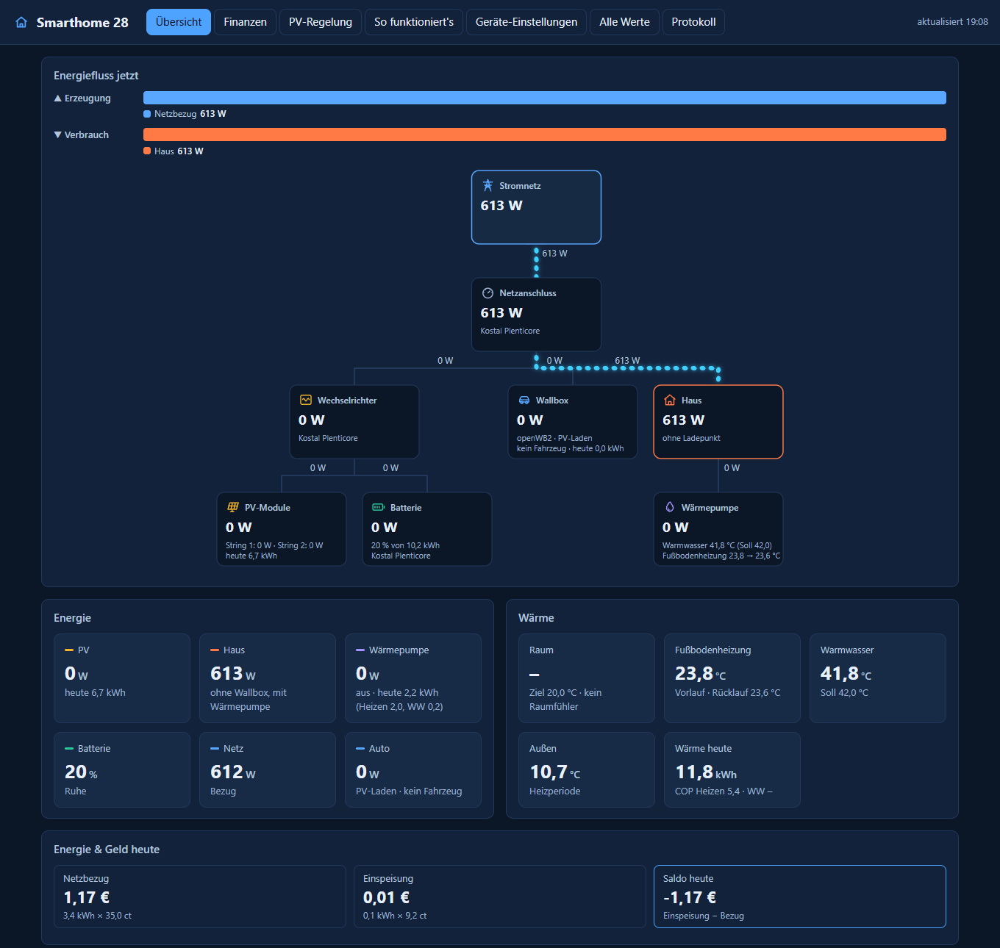
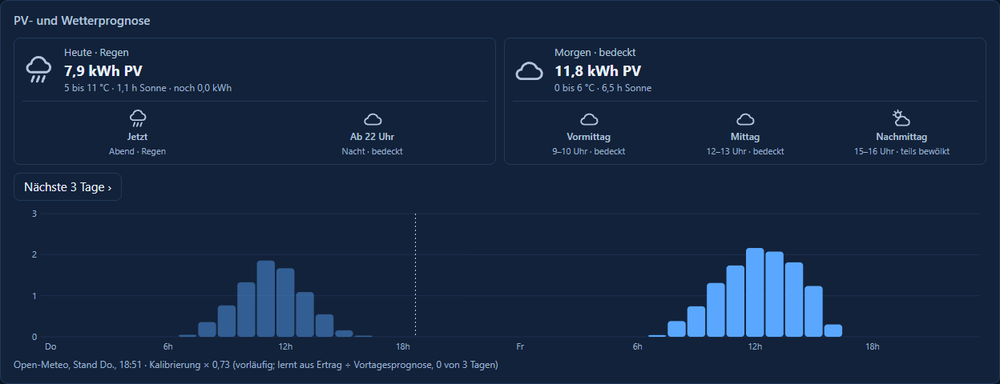
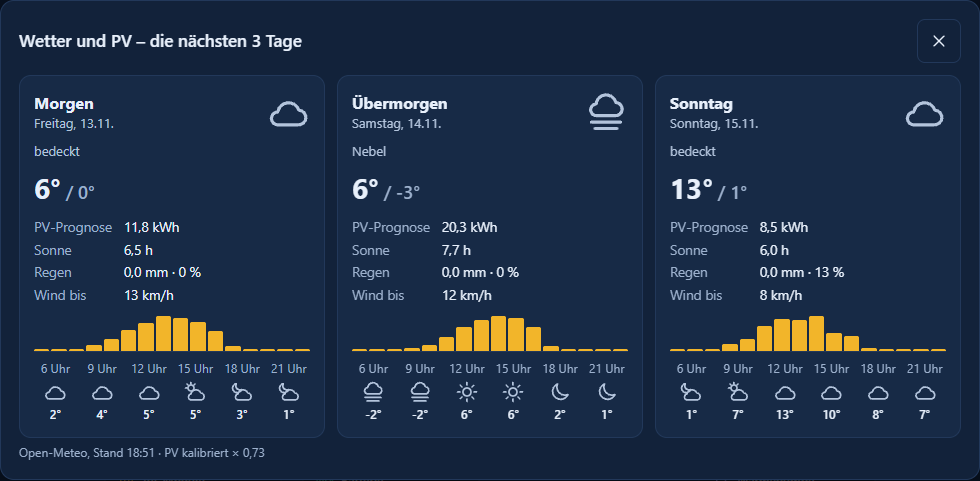
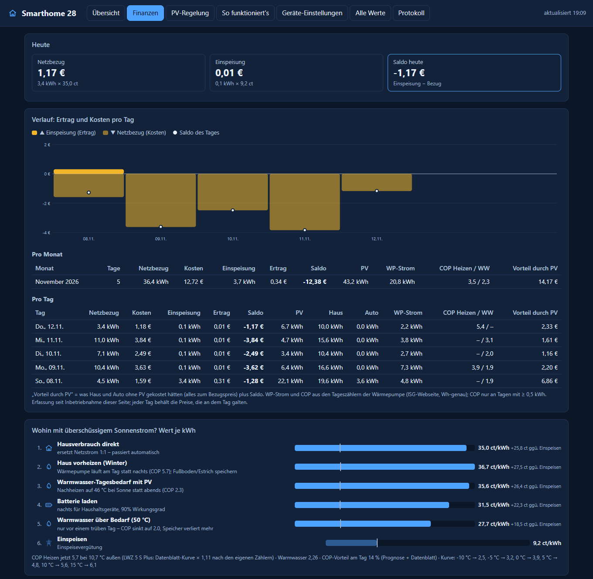

# Smarthome 28

Local dashboard for the **Stiebel Eltron ISG** heat pump, the
**KOSTAL PLENTICORE plus** PV inverter with its battery and the
**openWB** wallbox, plus a PV-led hot water and heating controller that keeps the
house battery from paying for hot water. The pages, decisions, alerts and push messages are in
**English or German** (one setting; the screenshots show German).



## Highlights

### Weather and PV forecast



- **Free, no API key:** hourly *global tilted irradiance* from [Open-Meteo](https://open-meteo.com/)
  for each PV array (tilt, azimuth, kWp) → expected yield per hour, with the weather of each hour.
- **Learns your roof:** every day the dashboard stores the day-ahead forecast and compares it with
  the inverter's real yield. The calibration factor is Σ real yield ÷ Σ day-ahead forecast over
  the last 21 days, so shading, soiling and inverter losses are corrected automatically
  ("Kalibrierung × 0,73"; marked provisional until 3 days are logged).
- **Today and tomorrow at a glance:** kWh, temperatures, sunshine hours, the weather now and in the
  next part of the day, and hourly PV bars for both days.
- **3-day outlook** (click a day or „Nächste 3 Tage“): weather every 3 hours, min/max temperature,
  rain (mm and probability), wind, sunshine and the hourly PV profile per day.
- **It drives the control:** hot water waits for tomorrow's sun instead of reheating from the grid,
  stores extra heat before a dull day, and the floor heating lowers its target overnight when
  the sun will come.



### Cost calculation



- **A daily ledger with the prices valid that day:** grid import × buy price, feed-in × feed-in tariff
  and the balance, per day and per month. A price change only affects the days after it.
- **What PV really saves** („Vorteil durch PV“): what house and car would have cost from the grid
  without PV, plus the day's balance.
- **Heat pump electricity, measured:** kWh per day for heating and hot water from the heat pump's
  Wh day counters, the measured COP per day and month, and the electric backup heater's kWh, so
  expensive heater hours don't hide in the sum.
- **The value of a PV kWh per use** (merit order): direct use, preheating the house, hot water,
  charging the battery, hot water above the need, feed-in, each in ct/kWh with the live COP.
  This is the ranking the controllers follow.
- **Strategy simulation:** model days, the PV-led strategy against fixed targets, with the live
  settings.

## Site topology

Read live from openWB (`openWB/counter/get/hierarchy`):

```
Grid
└── Grid connection (counter 0, the Kostal Plenticore meter)
    ├── Kostal Plenticore inverter (inverter 2) ← PV modules (DC1, DC2)
    │   └── Kostal Plenticore battery (bat 4, DC-coupled)
    ├── openWB2 (charge point 6, 3-phase, PV charging)
    └── House (the rest, computed by openWB)
        └── Heat pump (no meter of its own)
```

The Kostal's house consumption includes the wallbox (same meter); the dashboard uses
openWB's home consumption, which excludes it.

Python 3.11+, **no dependencies** (stdlib only), vanilla JS front end with no build step.

## Run

```bash
python C:/Src/home-energy/run.py
```

Open http://127.0.0.1:8085/. Config is saved to `config.json`, state and the decision
log to `data/`. Enter your devices' LAN addresses in `config.json` first
(`"devices": {"isg": "…", "kostal": "…", "openwb": "…"}`; empty openwb = no wallbox). By default the server only listens on this PC; set `web_host` to
`0.0.0.0` in `config.json` for LAN access. **There is no login**, so only do that on
a trusted network.

CLI:

```bash
python -m homeenergy read isg
python -m homeenergy read kostal
python -m homeenergy set isg dhw_day 46
```

Tests: `python -m unittest discover -s tests`

**Room sensor.** The LWZ has no room sensor: its "Raum-Ist HK1" is just its room target echoed
back, so the heating strategy ignores it. A real sensor pushes its readings to
`GET or POST /api/sensor/room?t=<°C>&h=<%>` (also `tC`/`rh`; 5–35 °C accepted). A reading counts for
3 h (PV-Regelung → „Raumfühler gilt“); without one the PV heating fills its buffer target without
the „Puffer voll“ check. Shelly H&T Gen3 (local, no cloud), in its web interface → Actions, add one
action each for *temperature change* and *humidity change* with this URL:

```
http://<server>:8085/api/sensor/room?t=${status["temperature:0"].tC}&h=${status["humidity:0"].rh}
```

Run it on USB power if possible (it then reports more often), place it in the living room away from
sun, the floor heating's hottest spot and outside walls. With a Stiebel room control unit instead, tick
„Raumtemperatur von der Wärmepumpe“. The minute history records it as `room_sensor` / `room_humidity`.

Heat pump settings backup (read only): `python tools/isg_backup.py <isg-address>` saves every ISG setting,
time program and the raw Modbus setting registers to `backups/isg-settings-<date>.json` and a
readable `.md` (`backups/` is git-ignored: it holds your own settings). This is what a replacement control board would need re-entered; run it again after
changing settings on the ISG.

## Production: NAS (Docker)

Runs on a NAS as container `home-energy`: **http://&lt;nas&gt;:8085/**
(restart policy `unless-stopped`; logs also in Dozzle on port 38080).

```
<DIR>/          code + Dockerfile + compose.yaml
<DIR>/config/   config.json, data/ (state.json, decisions.jsonl)
```

Update after code changes (from this PC, Git Bash; copy `deploy.env.example` to `deploy.env` first):

```bash
./deploy.sh
```

It runs the tests (and `node --check` on the web modules) and stops if one fails, lists files on
the NAS that no longer exist here (`--prune` deletes them), copies the code, rebuilds the
container and waits for the first control cycle, then shows each device's read status.

**Alerts.** Checked once per control cycle; a problem must last its delay before it counts:
device without data (10 min, adjustable), failed write to the heat pump (at once), hot water
below 36 °C (30 min, adjustable), forecast unavailable for over 3 h. Active alerts show as a
banner on every tab. For push messages enter an ntfy topic under PV-Regelung → „Hinweise & Push“
(e.g. `https://ntfy.sh/<long-secret-word>`, subscribe to the same topic in the ntfy app; the topic
name is the only protection, so make it long) and press „Testnachricht senden“. One message when an
alert starts, one when it is over. Separately, once a day: the electric backup heater (Heizstab) ran
≥ 1 kWh today (adjustable, 0 = off), with its cost; the overview's „Wärme heute“ tile shows its kWh
and Finanzen shows it under the heat pump electricity per day and month (it is already inside the
grid import and its cost; shown so it isn't hidden in the sum).

**Error log** (tab „Protokoll“, `GET /api/log`): every warning and error the service logs
(device read failures, failed writes, forecast/push problems, crashed requests) plus restarts,
devices answering again and alerts that are over. Stored in the `events` table of the SQLite
database (so it survives restarts and is in the nightly backup), 90 days; the same message within
10 minutes counts up on one row (`eventlog.py`, `store.add_event`).

**Only one instance may control the heat pump.** The PC copy's `config.json` has
`"apply": false`; keep it that way when running the dashboard locally for development.

## Tabs

Tab names in English, with the German UI name in parentheses.

- **Overview** („Übersicht“): producer/consumer balance bars and an energy-flow diagram drawn from
  the openWB topology (animated in the direction power flows), live tiles, money today, the
  controllers' decisions, the PV and weather forecast (click a day or „Nächste 3 Tage“ for the
  3-day outlook), power / hot water / battery charts (hover for values, „Tabelle“ for a table view).
- **Bath** („Bad vorbereiten“, a card on the overview): ask for hot water for a bath at a time
  (default 17:30, 55 °C). The controller heats with PV surplus first (even before the battery is
  full) and starts anyway at the computed latest start, so the bath is ready on time.
- **Finance** („Finanzen“): today's balance, a daily chart (feed-in income ▲ / grid cost ▼ /
  balance), daily and monthly tables including the benefit from PV, the merit order and the strategy
  simulation. The ledger (table `days` in the database) records each day's totals with the prices
  valid that day.
- **PV control** („PV-Regelung“): hot water strategy, PV heating (winter), forecast, write limit and
  alert/push settings; decision logs for hot water and heating.
- **How it works** („So funktioniert's“): a visual explanation of both controllers. The live part
  draws the trace that `decide()` / `decide_heating()` record for every decision (✓/✗ per check
  with the live values), plus a schematic sunny vs. dull day and the main settings.
  „An Wärmepumpe senden“ (send to the heat pump) is **off** by default: test mode, decisions are
  only shown.
- **Device settings** („Geräte-Einstellungen“): heat pump settings grouped like the ISG pages. Only
  registers that are confirmed are writable; the rest are shown read-only with the reason.
- **All values** („Alle Werte“): every value from every device; status codes are shown as text.
- **Log** („Protokoll“): warnings, errors, restarts and alerts, newest first.

## Architecture

```
homeenergy/
  modbus.py        Modbus TCP client (FC 3/4/6), thread-safe, reconnects
  mqtt.py          Read-only MQTT 3.1.1 subscriber (latest value per topic), reconnects
  registers.py     Point / Setting / DeviceSpec definitions, decoders, block planner
  device.py        Generic ModbusDevice: reads in blocks, validated write + read-back
  devices/         One map per device: stiebel_isg.py, kostal.py (Modbus), openwb.py (MQTT),
                   isg_web.py (ISG page: refrigerant temps, Wh day counters -> heat pump power)
  cop.py           LWZ 5 S Plus COP model: datasheet curve calibrated on the own counters
  flow.py          Energy-flow model from the openWB hierarchy (pure; Kostal fallback)
  forecast.py      Open-Meteo PV forecast, summary, self-calibration
  situation.py     The energy situation of one moment (surplus, battery need, free PV, sun up),
                   computed once and shared by both strategies and the simulation
  rules.py         Shared building blocks: Decision, Trace, RunState (start/stop timers)
  hotwater.py      Hot water decision logic (pure functions, no I/O, records a trace)
  heating.py       PV space heating: battery first, fine preheating, setback (pure, records a trace)
  economics.py     Value of a PV kWh per use (merit order), live COPs, money today
  finance.py       Daily/monthly money ledger (days table in the SQLite store)
  store.py         SQLite store: samples, 15-min averages, days, decisions; upkeep and backup
  migrate.py       One-time import of the JSON files used before SQLite
  simulate.py      Model days: strategy vs fixed targets (used by tests and the Finance tab)
  controller.py    Generic SetpointController (dry run, rate limits, restore, log);
                   DhwController (WW Soll Tag) and HeatingController (Raumtemp. Tag)
  config.py        Config dataclasses, JSON persistence, UI field metadata
  polling.py       One reader thread per device: latest values, freshness, read timings
  forecaster.py    Keeps the forecast fresh, logs day-ahead / same-day forecast vs real yield per day,
                   calibrates on Σ yield ÷ Σ day-ahead forecast
  eventlog.py      Logging handler: warnings, errors and marked events → events table (error log)
  alerts.py        Problems (device silent, failed write, cold tank, no forecast) → alert after a delay,
                   banner on the page, optional push to an ntfy topic when one starts and ends
  control.py       One control cycle: build the situation, run heating, then hot water
  bookkeeping.py   Daily ledger, minute history, nightly database upkeep and backup
  views.py         Read model: the JSON the pages get (read only)
  i18n.py          Texts: one catalog per language (lang/de.json, lang/en.json), t(key, **args), fnum()
  service.py       Wires the parts together; the methods the web layer calls
  web.py           HTTP server + JSON API
web/
  app.js           Wiring only: tabs, polling (paused while hidden), draws the visible tab
  state.js         Loads the state, joins it with the rarely changing meta (labels, rule texts, page texts)
  i18n.js          t(key, args) for the page, the locale for numbers and dates, data-i18n in index.html
  overview.js      Overview: tiles, flow, money, decisions, bath request, forecast
  timeline.js      Overview charts and the history they draw (48 h kept in the page, longer from the DB)
  controltab.js    PV control: decision logs and the settings forms
  explain.js       How it works: draws the steps the server sends next to the rules
  finance.js       Finance: money today, merit order, ledger
  details.js       All values: every device value
  alerts.js        Alert banner above every tab
  logtab.js        Log: the error log
  flow.js, balancechart.js, charts.js, forms.js, icons.js, lib.js, style.css, index.html
tests/             unit tests incl. a fake Modbus TCP server
docs/              strategy.md (research + rules + forecast), register-verification.md
```

Design rules that keep it maintainable:

- **Device maps are data.** To add a value, add one `Point(...)` line; the reader, API,
  "Alle Werte" table and settings form pick it up automatically.
- **Strategies are pure.** `hotwater.decide()` and `heating.decide_heating()` take a
  `Situation` plus their own config and state and have no I/O, so every rule is unit-tested
  with plain inputs (`tests/test_hotwater.py`, `tests/test_heating.py`).
- **Derived values exist once.** Surplus, battery need, free PV and "will the battery fill"
  are `Situation` properties; the service and the simulation build the same object, so
  they can't drift apart. Start/stop timers are `RunState.track_start/track_stop`.
- **One place talks Modbus.** The service polls; browser tabs only read cached snapshots.
- **Each device has its own reader thread** (Kostal, ISG, openWB every 10 s, ISG web pages every
  60 s), so a slow or hanging device never delays the others. The control loop only uses the
  latest snapshots and pauses when Kostal or ISG data is older than 90 s.
- **Cheap for the browser.** Only what changes travels every 10 s: `/api/state` carries device
  values as `{key: value}` and the last decisions (≈ 14 KB, 4–5 KB gzip). Labels, units and the rule
  texts come from `/api/meta`, fetched again only when its `version` (in every state) changes; the
  decision logs come from `/api/decisions`, only while PV-Regelung is open. `web/state.js` joins
  state and meta back into one object. Only the visible tab is drawn; a hidden one when opened.
  History travels as columns (`format=columns`: each name once, watts as integers) – the 48 h
  are ≈ 180 KB (30 KB gzip) once, then only the new minutes (`since=<unix s>`). Charts thin
  points to the chart width, polling pauses in hidden browser tabs, ranges beyond 48 h come
  from the database, averaged server-side. Measured 11.11.2026: state 108 → 14 KB, history
  640 → 180 KB, server time per state 5 → 1.7 ms, page heap ≈ 3 MB without growth.
- **One SQLite file** (`config/data/home-energy.sqlite`, `store.py`, stdlib `sqlite3`, WAL):
  minute samples (90 days), 15-minute averages with min/max of temperatures (5 years), the daily
  ledger (forever) and control decisions (90 days). A new value becomes a new column on its own;
  a value no longer recorded is listed in `store.RETIRED` and its column dropped by a schema step
  (schema 3 dropped `room_temp`, the ISG's echo of its room target).
  Every 15 min the averages are updated; at 03:00 old rows are pruned and a consistent copy is
  written to `config/data/backup/home-energy-<weekday>.sqlite` (7 rolling copies). The JSON files
  used before (history.jsonl, finance.json, *decisions.jsonl) were imported once and then moved,
  unchanged, to `config/data/backup/legacy-json/`.
- **Measured.** `GET /api/perf`: read time per device, control time, API sizes, data file sizes and
  database row counts.
- **Each setting is declared once**, on its config dataclass field (`num()`, `flag()`, `clock()`
  or `hidden()` from `settings.py`, with label, unit, limits and help). The settings forms and
  their validation are generated from that (`config.UI_FIELDS`); a test fails if a field is
  neither shown nor marked hidden.
- **Rule texts live next to the rules.** `hotwater.stages()` / `heating.stages()` describe the
  checks in the order `decide()` makes them, with the mode labels and outcome names beside them;
  the state sends them as `controller.explain` / `heating.explain`, and the pages only draw
  them. `tests/test_explain.py` fails when a rule checks something without a step or a step
  names a check no rule makes.
- **One module per tab** in `web/`; `app.js` only wires tabs and polling.
- **Texts live in catalogs, not in the code.** Every text the pages, decisions, alerts and pushes
  show is a key in `homeenergy/lang/<code>.json` (flat `{"key": "text"}`, named `{placeholders}`);
  the code holds keys and values only: `t("dhw.reason…", kwh=fnum(x))` in Python, `t("web.…", {…})`
  in the page, `data-i18n="web.html.…"` in `index.html`. Setting labels are `cfg.<section>.<field>`
  (+ `.help`), device values `dev.<device>.<key>`; values that were German words are codes now
  (`hp_mode` `heating`/`dhw`, openWB yes/no `1`/`0`, controller `outcome` `written`/`failed`).
  The language is one setting (PV control → Display → Language, config `"ui": {"language": "de"}`);
  a new installation starts in English. Stored logs keep the language they were written in.
  **Adding a language:** copy `en.json` to `<code>.json`, translate every value, add the code to
  `i18n.LANGUAGES`. `tests/test_i18n.py` fails on a missing or extra key, a different placeholder,
  an untranslated copy, a key the code uses but no catalog has, and any German literal left in the code.

## Safety

- Settings are range-checked and written with read-back verification.
- openWB is connected read-only (subscribe only). Charge mode etc. stay in the openWB UI.
- Only registers confirmed by a write test or a unique value match are writable; the rest are
  read-only (see `docs/register-verification.md`).
- The controller writes at most once per 10 min and 24 times a day, never acts on stale
  data, and restores the comfort temperature when switched off.
- While the controller is live, WW Soll Tag can't be changed from the settings tab.
  Change "Komforttemperatur" in the controller instead.
